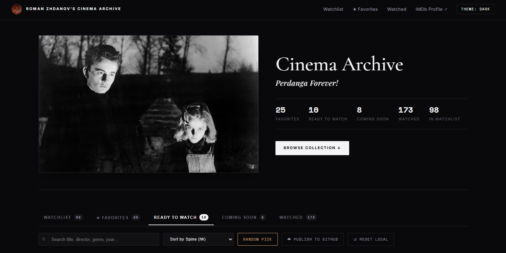

# Cinema Archive



Personal curated cinema archive, watchlist, and ratings management system.

## Features

- Sections: Watchlist, Favorites, Ready to Watch, Coming Soon, Watched.
- Personal film ratings (1-10 scale) alongside IMDb scores.
- Random Pick selector for discovering what to watch next.
- Automated IMDb synchronization pipeline with poster and trailer fetching.
- Client-side curation with direct publishing to GitHub via API.
- Responsive interface with dark and light themes.

## Structure

- `index.html`: Web application interface and client-side logic.
- `sync.py`: IMDb synchronization and metadata pipeline.
- `data/curated.json`: Film identifiers for curated lists.
- `data/movies_data.json`: Compiled movie metadata and ratings archive.
- `data/posters.json`: Poster image URLs.
- `data/trailers.json`: YouTube trailer identifiers.

## Synchronization

```bash
python sync.py
```
